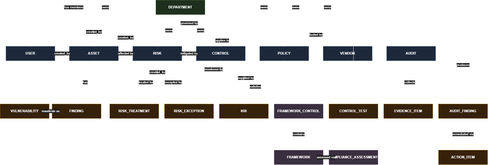

<div align="center">

# GRC Nexus

### Governance · Risk · Compliance — unified in one correlated graph.

**Where is our risk concentrated, and what are we doing about it?**

[](https://www.python.org/)
[](https://www.djangoproject.com/)
[](https://www.postgresql.org/)
[](https://docs.docker.com/compose/)
[](#testing)
[](LICENSE)

</div>

---

## Overview

**GRC Nexus** is a full-stack Governance, Risk and Compliance platform built around
**department-level ownership**. Every Head of Department owns their own risks, controls and
policies; the executive layer sees the org-wide picture. It is a single, correlated graph of
assets, vendors, risks, controls, policies, frameworks, audits and vulnerabilities — not a set
of disconnected registers.

It is designed for mid-size organisations and for security/GRC practitioners who want a
realistic, self-hostable platform rather than a spreadsheet sprawl.

---

## Why it's different

- **Correlation engine** — objects know their relationships. Creating an asset automatically
  raises a baseline risk, links applicable policies, and ties into vendor and control views.
- **Cascade scoring** — change a control's effectiveness and every risk it mitigates has its
  residual score recomputed against department-specific appetite thresholds. A vulnerability
  finding cascades into the risk register automatically.
- **Defence-in-depth risk maths** — residual risk is reduced multiplicatively by weighted,
  evidence-gated controls (never additively), so a stack of "perfect" controls can never drive a
  risk to zero. See [Architecture](#architecture).
- **Department-scoped RBAC** — enforced at the *queryset* level (`core/mixins.py`), not just in
  the UI. A user with no department sees nothing rather than everything.
- **Cross-framework mapping** — one control satisfies many framework requirements
  (ISO 27001 + NIST + CIS) with relationship types and weighted coverage.
- **Model history** — `django-simple-history` tracks who changed what, and when, on the core
  domain models.

---

## Feature highlights

### Governance & inventory
- **Asset inventory** — `AST-XXXX` IDs, hostname, IP, FQDN, OS, cloud provider/region,
  location, classification, CIA ratings and business context.
- **Relationship Explorer** — interactive force-directed graph of
  asset ↔ vendor ↔ risk ↔ control ↔ policy ↔ framework connections.
- **Classification & owner views** — grouped by Public/Internal/Confidential/Restricted, and by
  department or individual.
- **Vendor register** — `VEN-XXXX` IDs, service type, tier and compliance attestations.
- **Vendor risk assessment** — 5-dimension scoring (Security, Compliance, Financial,
  Reputation, Operational) with an auto-computed overall rating.
- **Policy library** — versioning, an approval workflow (Draft → Review → Approved, named
  approver required), applies-to departments, and PDF attachment.

### Risk & controls
- **Risk register** — inherent/residual scoring, appetite-breach flagging, treatment plans.
- **Risk appetite** — appetite level (Averse → Hungry), statements, board approval and
  thresholds; registration beyond capacity is blocked.
- **Risk matrix** — side-by-side inherent vs residual 5×5 grids, clickable cells, quick-add.
- **Workflow state machine** — risks move through legal transitions only; closing a risk that
  breaches appetite requires a named approver.
- **Risk exceptions** — formal risk acceptance with approver, expiry and auto-expiration.
- **Controls** — lifecycle, effectiveness rating (evidence-gated: no test date, no rating),
  frequency and primary framework.
- **Framework matrix** — Control × Framework grid with relationship types and coverage %.
- **Control lifecycle board** — kanban: Proposed → Designed → Implemented → Operational →
  Monitored → Reviewed → Retired.
- **Key Risk Indicators** — RAG status, trends, linked risks/appetites, 6-month trend chart.
- **Vulnerabilities** — CVE catalogue with live NVD/EPSS/KEV enrichment and a composite risk
  score. Findings cascade into the risk register; remediation auto-closes the derived risk.

### Compliance
- **Framework coverage** calculated with relationship weights.
- **Compliance status** dashboard across all frameworks.
- **Compliance assessments** — readiness checklists with auto-populated items per framework.
- Ships with a seeder for **ISO/IEC 27001, NIST CSF, SOC 2, PCI DSS, GDPR and CIS Controls**
  (500+ framework requirements).

### Audit & assurance
- **Audit schedule** — types (External / Internal / Self-Assessment) and a status workflow,
  plus a kanban timeline.
- **Evidence library** — screenshots, exports, configs and logs linked to controls.
- **Evidence scoring** — 5-dimension evaluation (Relevance, Completeness, Timeliness,
  Reliability, Sufficiency) → 0–100 score with rating bands.
- **Control testing** — 8 result types (Pass, Partial, Fail, Self Audit, Continuous Monitoring…).
- **Audit findings** — severity, source, owner, due date, recommendation, overdue tracking.
- **Action plans** — sub-tasks under findings with `ACT-XXXX` IDs, priority and progress.
- **Per-audit PDF report** — full engagement report with findings, tests, evidence and sign-off.

### Threat intelligence
- **MITRE ATT&CK matrix** — tactics × techniques, highlighting techniques with matching IOCs.
- **Threat actors** — APT groups with attributed techniques.
- **IOC feed** — live indicators (ThreatCluster / ThreatFox / OTX) with enrichment
  (first_seen, last_seen, malware_family, confidence).

### Reporting
- **Executive report** — multi-page narrative PDF with embedded charts, cover, TOC and
  auto-generated recommendations.
- **Asset inventory**, **risk register** and **vulnerability findings** — PDF + Excel.
- **Per-audit report** — full engagement PDF.
- All generated PDFs carry a confidentiality watermark (one seal per page).

### Platform
- **Login & RBAC** — department-scoped, enforced at the queryset level; `django-guardian` is
  installed and available for future object-level permissions.
- **Command palette** (Ctrl/⌘ + K) — search across assets, risks, controls, policies, vendors,
  findings, audits, frameworks, KRIs, tickets and threat actors.
- **Notifications** — a department-scoped work queue (unread is real unread).
- **Dark mode** with persistence; native `type="date"` calendar pickers everywhere.
- **CSV / Excel / PDF export** on the list views that support it.
- **Authorised media downloads** — evidence and policy documents are served through a login- and
  department-scoped view (`core/media.py`), never raw `/media/`.
- **Accessibility & responsive** — skip link, live regions, visible focus states, print
  stylesheet, reduced-motion support and an off-canvas mobile sidebar.

---

## Tech stack

| Layer | Technology |
|---|---|
| Backend | Django 4.2 LTS · Python 3.11 |
| Database | PostgreSQL 16 |
| Frontend | Django Templates · Bootstrap 5.3 · HTMX · Chart.js · vis-network |
| Reporting | WeasyPrint (PDF) · matplotlib (charts) · openpyxl (Excel) |
| External data | NIST NVD · FIRST EPSS · CISA KEV · MITRE ATT&CK (STIX) · ThreatCluster · abuse.ch ThreatFox · AlienVault OTX |
| Auth | Django auth + department-scoped queryset RBAC (`django-guardian` available) |
| History | `django-simple-history` |
| Server | gunicorn + WhiteNoise |
| Config | `python-decouple` (12-factor) |
| Infra | Docker · Docker Compose |

---

## Architecture

GRC Nexus is a modular Django project. Business logic lives in a service layer
(`*/services.py`), authorization lives in one place (`core/mixins.py`), and mutations ripple
through signals. Views stay thin.

```
grc-nexus/
├── app/
│   ├── config/            # settings (base/dev/prod), urls, wsgi
│   ├── core/              # users, departments, dashboard, search, notifications, media, mixins
│   ├── frameworks/        # frameworks, requirements, coverage, assessments
│   ├── assets/            # asset inventory + relationship explorer
│   ├── vendors/           # vendor register + risk assessments
│   ├── policies/          # policy library + lifecycle workflow
│   ├── controls/          # control library, effectiveness, evidence
│   ├── risks/             # register, appetite, treatments, exceptions, cascade engine
│   ├── vulnerabilities/   # CVE catalogue, findings, NVD/EPSS/KEV enrichment, cascade
│   ├── kris/              # key risk indicators + readings
│   ├── audits/            # audits, evidence, scoring, testing, findings, actions
│   ├── threatintel/       # ATT&CK matrix, actors, IOC feeds
│   ├── tickets/           # remediation tickets + alerting
│   ├── templates/         # shared + per-app templates
│   └── static/            # CSS design tokens, JS, brand assets
├── docs/                  # audit record and PDF previews
├── docker-compose.yml
├── .env.example
└── README.md
```

**The cascade, in one line:** `Asset → baseline risk → controls → residual score → appetite
breach → escalation`, and `Vulnerability finding → risk → treatment → remediation → auto-close`.

**Residual scoring model** (`risks/services.py`):

```
reduction_i = min(MAX_SINGLE_CONTROL_REDUCTION, effectiveness_ratio_i × type_weight_i) × CONTROL_CONFIDENCE
remaining   = Π (1 − reduction_i)
residual    = inherent × remaining          # clamped to 1–25 when inherent > 0
```

Control-type weights: preventive `1.0`, corrective `0.8`, detective `0.7`. Effectively-tested
controls reduce more; untested/ineffective controls reduce nothing. The residual never reaches
zero while a risk has any inherent score.

The entity relationships are in the bundled ER diagram:



---

## Quick start

### Prerequisites
- **Docker Desktop** (with WSL 2 on Windows) — the only hard requirement
- **Git**

### 1. Clone

```bash
git clone https://github.com/SujalAdhikari-Hacker/GRC-Nexus.git
cd GRC-Nexus
```

### 2. Configure the environment

```bash
cp .env.example .env
```

The defaults work out of the box. Edit `.env` only if you want a custom `SECRET_KEY` or
different database credentials.

> **Important:** `SECRET_KEY` must **not** contain a `$` character — `docker compose`
> interpolates `$…` in `.env` files, which silently corrupts the key. Generate one with:
> `python -c "import secrets; print(secrets.token_urlsafe(64))"`

### 3. Build and start

```bash
docker compose up --build
```

The first build takes a few minutes. The `web` container waits for PostgreSQL, applies
migrations automatically, collects static files, then starts **gunicorn** (production settings)
on port `8000`.

### 4. Load demo data (optional but recommended)

In a second terminal:

```bash
docker compose exec web python manage.py seed_demo
docker compose exec web python manage.py createsuperuser
```

### 5. Open the app

| | |
|---|---|
| App | <http://localhost:8000> |
| Admin | <http://localhost:8000/admin> |

Seeded demo users all use the password **`demo1234`** (for example `it_hod`, `fin_hod`).

---

## Demo data

`seed_demo` is idempotent and creates a realistic starting point: departments, HOD/demo users,
asset categories and assets, vendors with assessments, policy categories and policies, controls,
risk categories, appetites and risks, plus the compliance frameworks and their requirements.

```bash
# Core demo dataset (departments, users, assets, vendors, policies, controls, risks, frameworks)
docker compose exec web python manage.py seed_demo

# Optional extras
docker compose exec web python manage.py seed_frameworks_extra   # additional frameworks
docker compose exec web python manage.py seed_kris               # key risk indicators + readings
docker compose exec web python manage.py seed_vulnerabilities    # sample CVE catalogue
docker compose exec web python manage.py populate_assessment_items

# Remove seeded/test data
docker compose exec web python manage.py clean_test_data
```

**Demo credentials:** every seeded user's password is `demo1234`. Use `createsuperuser` to make
your own admin, or sign in as a seeded HOD to see department scoping in action.

---

## Configuration

### Environment variables (`.env`)

| Variable | Purpose |
|---|---|
| `DJANGO_SETTINGS_MODULE` | `config.settings.prod` (container) or `config.settings.dev` (local) |
| `DEBUG` | `False` by default; set `True` only for local debugging |
| `SECRET_KEY` | Long random string, **no `$`** |
| `ALLOWED_HOSTS` | Comma-separated hostnames |
| `CSRF_TRUSTED_ORIGINS` | Comma-separated origins allowed to POST |
| `SECURE_SSL_REDIRECT`, `SESSION_COOKIE_SECURE`, `CSRF_COOKIE_SECURE`, `SECURE_HSTS_SECONDS` | TLS switches — relaxed for local HTTP, enable behind a TLS proxy |
| `SERVE_MEDIA` | Legacy flag; media is served through the scoped view regardless |
| `POSTGRES_DB`, `POSTGRES_USER`, `POSTGRES_PASSWORD`, `POSTGRES_HOST`, `POSTGRES_PORT` | Database connection |
| `ABUSECH_AUTH_KEY`, `OTX_API_KEY` | Optional; enable ThreatFox / OTX IOC sync |

See [`.env.example`](.env.example) for the annotated list.

### Settings layout

Configuration lives in `app/config/settings/`:

| Module | Purpose |
|---|---|
| `base.py` | Environment-neutral settings; values read via `python-decouple` |
| `dev.py` | Permissive local development (`DEBUG=True`, relaxed security) |
| `prod.py` | Hardened defaults (HTTPS, HSTS, secure cookies) as shipped in the container |

Select the module with `DJANGO_SETTINGS_MODULE`.

---

## Common commands

```bash
docker compose logs -f web                                  # follow app logs
docker compose restart web                                  # after editing code (gunicorn does not hot-reload)
docker compose exec web python manage.py migrate
docker compose exec web python manage.py collectstatic --noinput
docker compose exec web python manage.py recompute_risk_scores   # re-derive residual scores
docker compose exec web python manage.py scan_for_alerts         # generate remediation tickets
docker compose exec web python manage.py sync_attack_data        # MITRE ATT&CK data
docker compose exec web python manage.py sync_recent_cves        # latest CVEs from NVD
docker compose exec web python manage.py test                    # run the test suite
docker compose down                                              # stop
docker compose down -v                                           # stop and wipe the database
```

> Editing code? The project is bind-mounted (`./app:/app`), so changes are picked up on
> `docker compose restart web` — gunicorn does not auto-reload.

---

## Testing

The suite covers the invariants the product depends on: risk-scoring maths and the non-zero
residual floor, severity banding, the risk/policy state machines, control evidence gating, the
vulnerability→risk cascade, department scoping and the authenticated media view, CSV-injection
guarding, export fidelity and the PDF watermark.

```bash
docker compose exec web python manage.py test
# Ran 42 tests — OK
```

---

## Security

- **Authorization is centralised** in `app/core/mixins.py` (`scope_queryset`, `user_can_access`,
  …). Views must never hand-roll department filtering.
- **Uploaded files are not public.** Evidence and policy documents are served through
  `core/media.py`, which requires a login and only serves a file when the user can see a record
  that references it. The raw `/media/` mount is removed. Path-traversal and symlink escapes are
  rejected.
- **CSV/Excel formula injection** is neutralised on export.
- **No secrets in the repo** — `.env`, `staticfiles/` and `media/` are git-ignored.
- Report any vulnerability privately (see [Contributing](#contributing)) rather than opening a
  public issue.

---

## Contributing

Contributions are welcome — bug reports, features, docs and tests.

1. **Fork** the repo and create a branch:
   ```bash
   git checkout -b feat/short-description
   ```
2. **Make your change.** Keep the existing patterns:
   - business logic in `*/services.py`, not in views or templates;
   - all authorization via `core/mixins.py`;
   - add a regression test under the relevant app's `tests.py`.
3. **Run the checks** before committing:
   ```bash
   docker compose exec web python manage.py check
   docker compose exec web python manage.py makemigrations --check --dry-run
   docker compose exec web python manage.py test
   ```
4. **Commit** with a clear message (imperative mood, e.g.
   `fix: cap residual risk at a non-zero floor`).
5. **Open a pull request** describing the change and how you verified it.

Attribution and a fuller contribution guide live in [CONTRIBUTORS.md](CONTRIBUTORS.md).

---

## Releases & versioning

GRC Nexus follows [Semantic Versioning](https://semver.org/). Releases are cut as annotated,
signed-off tags on `main`.

```bash
git tag -a v2.3.0 -m "GRC Nexus v2.3.0"
git push origin v2.3.0
gh release create v2.3.0 --title "GRC Nexus v2.3.0" --notes "See CHANGELOG"
```

Existing tags: `v1.0.0`, `v2.0.0`, `v2.1.0`, `v2.2.0`.

---

## Roadmap

The platform is under active development. Planned work:

- [ ] Object-level permissions via `django-guardian` (installed, not yet wired)
- [ ] Email digests and escalation notifications
- [ ] Audit finding → verification loop; bulk actions and saved views
- [ ] Design-system cleanup (reduce inline styles to tokens)
- [ ] SSO / OIDC and MFA for enterprise deployments

---

## License

Released under the [MIT License](LICENSE).

---

## Acknowledgements

- **Sujal Adhikari** — Creator, architect and lead developer · [@SujalAdhikari-Hacker](https://github.com/SujalAdhikari-Hacker)
- Built with [Django](https://www.djangoproject.com/), [Bootstrap](https://getbootstrap.com/),
  [HTMX](https://htmx.org/), [Chart.js](https://www.chartjs.org/), [vis-network](https://visjs.github.io/vis-network/docs/network/),
  [WeasyPrint](https://weasyprint.org/) and [openpyxl](https://openpyxl.readthedocs.io/).
- Threat data from [NIST NVD](https://nvd.nist.gov/), [FIRST EPSS](https://www.first.org/epss/),
  [CISA KEV](https://www.cisa.gov/known-exploited-vulnerabilities-catalog) and
  [MITRE ATT&CK](https://attack.mitre.org/).

<div align="center"><sub>Built for people who take governance, risk and compliance seriously.</sub></div>
